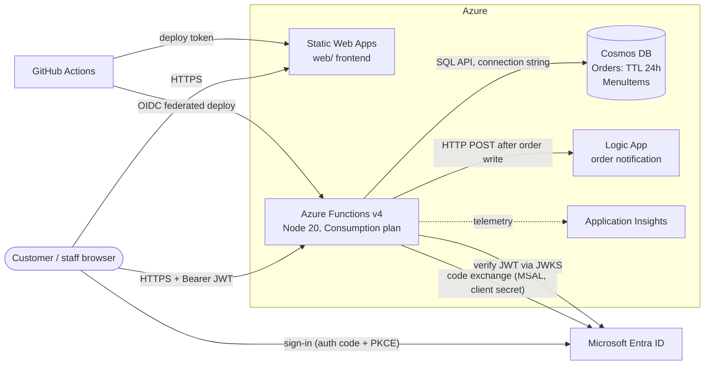

# Food Express — Architecture

> Status: work in progress (Oct 2026). Open items are tracked in [WELL-ARCHITECTED.md](WELL-ARCHITECTED.md).

## 1. Context

Food Express lets customers at a food stall order from their phone and lets stall staff run the queue.

| Actor | What they do | How they sign in |
| --- | --- | --- |
| Customer | Browse menu, place an order, track it, confirm pickup | Microsoft account via Entra ID |
| Stall staff | See all orders, move them through the lifecycle, edit the menu | Same, with the `StallStaff` app role |
| Admin / ops | Read order statistics | `x-admin-key` header |

Order lifecycle: `pending → preparing → ready → completed` (customer confirms), or `cancelled` by staff before completion.

## 2. Diagram

## 3. Components

| Component | Azure service | Why this one | Alternative considered |
| --- | --- | --- | --- |
| Frontend | Static Web Apps | Free tier, global CDN, deploys from GitHub | Blob static website + CDN |
| API | Functions v4, Consumption, Linux, Node 20 | Pay per execution, scales to zero, spiky lunch-time load ([ADR-0001](adr/0001-serverless-functions.md)) | App Service B1; Container Apps |
| Data | Cosmos DB for NoSQL, partition key `/id` | Schemaless documents, native TTL, point reads by order ID ([ADR-0002](adr/0002-cosmos-db-and-partition-key.md), [ADR-0006](adr/0006-ttl-for-order-expiry.md)) | Azure SQL Database |
| Identity | Entra ID, auth code + PKCE, confidential client | No passwords stored by us; roles as token claims ([ADR-0003](adr/0003-entra-id-pkce-confidential-client.md)) | Pure SPA flow with msal-browser |
| Authorisation | `StallStaff` app role; `x-admin-key` for stats | Role checked server-side on every staff call ([ADR-0004](adr/0004-app-role-and-admin-key.md)) | Admin app role for stats too |
| Notifications | Logic App (HTTP trigger), called by the server | No code for email/SMS connectors; client can't trigger it ([ADR-0005](adr/0005-server-side-notifications-logic-app.md)) | Storage queue + Function |
| CI/CD | GitHub Actions, OIDC to Azure | No long-lived deploy secret for the API | Publish profile secret |
| Monitoring | Application Insights (sampling on, requests excluded) | Built into Functions | Log Analytics only |

## 4. API

| Method | Route | Auth | In code? |
| --- | --- | --- | --- |
| GET | `/api/menu` | none | yes (`orders.js`) |
| POST | `/api/orders` | Bearer | yes |
| GET | `/api/orders/{orderId}` | Bearer, owner or staff | yes |
| PATCH | `/api/orders/{orderId}/acknowledge` | Bearer, owner, only when `ready` | yes |
| POST | `/api/auth/token` | none (PKCE code) | yes (`authToken.js`) |
| GET | `/api/stats/admin` | `x-admin-key` | yes (`admin.js`) |
| GET, PATCH | `/api/stall/orders…` | Bearer + `StallStaff` | planned |
| POST, DELETE | `/api/stall/menu…` | Bearer + `StallStaff` | planned |

## 5. Security

- **Authentication:** the browser runs the authorisation-code flow with PKCE; the Function exchanges the code using MSAL and the app's client secret, then returns the access token.
- **Token validation:** every protected handler calls `requireUser`, which verifies signature (JWKS, cached 12 h), issuer, audience and expiry. Clients only ever see a generic "Invalid or expired token".
- **Authorisation:** order reads check `customerId`; staff endpoints check the `roles` claim; the stats endpoint needs the admin key, compared with `timingSafeEqual`, and fails closed when unset.
- **Input trust:** the client sends only `itemId` and `quantity`; price comes from Cosmos DB server-side.
- **Secrets today:** Cosmos connection string (account key), Entra client secret, admin key and Logic App URL (contains a SAS signature) live in Function App settings. See the Well-Architected review for the move to Managed Identity and Key Vault.
- **CORS:** enforced in code via `ALLOWED_ORIGIN`. Not set in the deployed app, so it would default to `*` (open to any site).
- **Known issue:** the frontend renders data with `innerHTML`, allowing script injection from menu names and customer display names. See WELL-ARCHITECTED.md (priority H).

## 6. Data

| Container | Partition key | TTL | Main access pattern |
| --- | --- | --- | --- |
| `Orders` | `/id` | on; each order `ttl: 86400` (24 h) | point read by order ID; staff list and stats are cross-partition queries |
| `MenuItems` | `/id` | off | read all (small), point read by item ID |

Both containers are created by code with `createIfNotExists` on first use, and the menu is seeded with three items.

Deployed account: `foodorder-cosmos-babyclaire` (data region East US 2), provisioned throughput, free tier off, no total throughput limit. No containers exist yet: the app was never configured with a connection string, so the code's first-use creation never ran.

## 7. Non-functional

| Concern | Today | Notes |
| --- | --- | --- |
| Expected load | 1 stall, 200 orders/day, lunch peak ~50 orders in 15 min | Pilot assumption; used by COST.md |
| Latency | API and Cosmos DB both in **East US 2**; users in Singapore | ~200 ms round trip from SG on every call. Deploying both to Southeast Asia would cut this |
| Cold start | Consumption plan, scale to zero | First request after idle is slow; acceptable for pilot |
| Availability | Single region, no failover | See DR.md |
| Platform lifecycle | Linux Consumption is retiring on **30 Sep 2028** | Plan migration to Flex Consumption ([ADR-0001](adr/0001-serverless-functions.md)) |

> Deployment status (Oct 2026): subscription is in a Warned state (credit ended), so Azure has set the Function App foodorder-function-babyclaire (East US 2) to AdminDisabled. It was also never configured (no app settings), so the Cosmos DB containers were never created. Rebuild path: DR.md.
