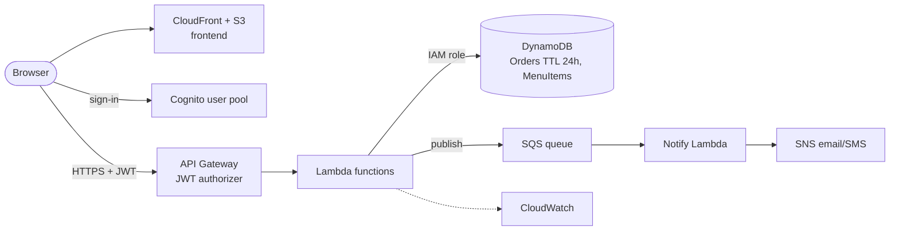

# Food Express on AWS — service mapping

How the same architecture would be built on AWS, and where the design would change rather than just swap names.

| Concern | Azure (today) | AWS equivalent | Design difference |
| --- | --- | --- | --- |
| Frontend hosting | Static Web Apps | S3 + CloudFront (or Amplify Hosting) | CloudFront adds edge caching and a WAF option |
| HTTP API | Functions v4 (HTTP triggers) | API Gateway (HTTP API) + Lambda | API Gateway can do JWT validation itself, before Lambda runs |
| Documents + TTL | Cosmos DB for NoSQL | DynamoDB (on-demand capacity) | DynamoDB TTL is also native; partition-key reasoning (ADR-0002) carries over directly |
| Sign-in | Entra ID, auth code + PKCE | Amazon Cognito user pool (hosted UI, PKCE), or keep Entra ID via OIDC federation | Staff role → Cognito **group**, read from the `cognito:groups` claim |
| Notifications | Logic App (HTTP trigger) | SNS for email/SMS; EventBridge or SQS to decouple | Making notification async (ADR-0005's alternative) is the default AWS pattern |
| Secrets | App settings → Key Vault (recommended) | Secrets Manager / SSM Parameter Store | Lambda execution **role** reaches DynamoDB with no keys (like Managed Identity) |
| Monitoring | Application Insights | CloudWatch Logs, metrics, alarms; X-Ray tracing | |
| CI/CD auth | GitHub OIDC → Entra federated credential | GitHub OIDC → IAM role | Same pattern: no long-lived cloud keys in GitHub |
| IaC | (to do) Bicep or Terraform | Terraform or AWS SAM/CDK | Terraform would cover both clouds |

## Reference AWS architecture

The biggest change is that sending a notification moves off the order request path, into a queue with retries.
